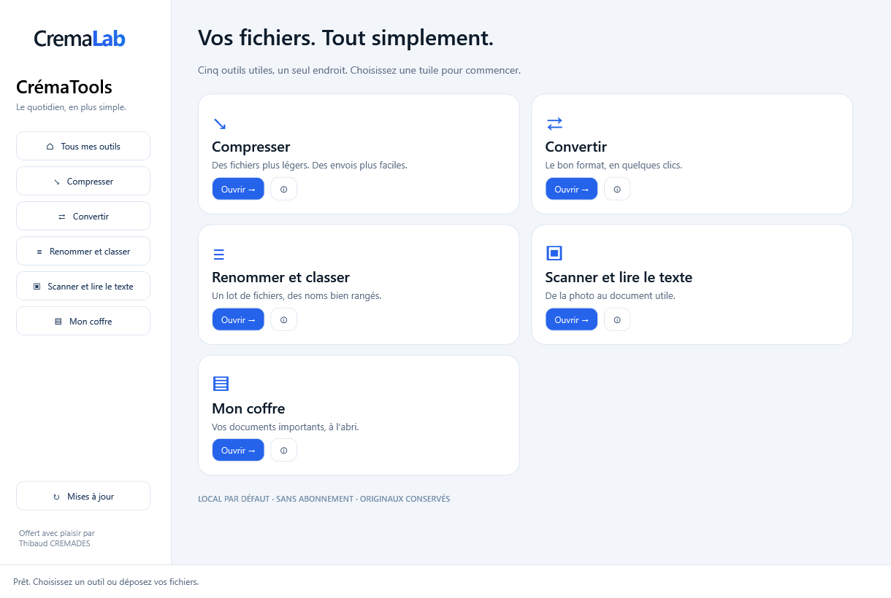

# CrémaTools · CremaLab

**Vos fichiers. Tout simplement.**

Un logiciel Windows pour compresser, convertir, renommer, scanner et garder ses documents importants dans un coffre chiffré local.

## Télécharger

**[Télécharger l’installateur Windows](https://github.com/thibaud-afk/crematools-updates/releases/latest)**

Windows 10/11 x64. Pas de compte en ligne, pas d’abonnement, pas de Node.js ou Python à installer. Le logiciel est autonome. L’installateur n’a pas de certificat d’éditeur : Windows peut demander une confirmation.

| Outil | Fonctions |
|---|---|
| Compresser | Réduire des images ou PDF, créer des archives ZIP/7z |
| Convertir | JPEG, PNG, WebP, HEIC dans les deux sens, TIFF, BMP, AVIF, images vers PDF, PDF vers images, réunir des PDF |
| Renommer et classer | Compteur 001, noms personnalisés, date, aperçu, classement par type ou année, annulation |
| Scanner | Reconnaissance de texte locale en français et autres langues installées, Word modifiable, texte, PDF recherchable |
| Coffre | Profils locaux, catégories personnalisables, chiffrement, clé de récupération, sauvegarde chiffrée et restauration |

Les fichiers originaux sont conservés par les outils de conversion, compression et scanner. L’outil de renommage déplace les fichiers uniquement après validation de l’aperçu.

## Coffre et sauvegardes

Les documents et leurs noms sont chiffrés avant stockage. La phrase secrète comporte au moins 12 caractères. La clé de récupération doit rester secrète et séparée du coffre. Sans phrase secrète ni clé, aucune récupération n’est possible.

Le coffre est local : exportez une sauvegarde chiffrée sur un autre support. La synchronisation cloud n’est pas incluse dans cette première version. Les originaux importés restent à leur emplacement d’origine ; une copie exportée n’est plus chiffrée par le coffre.

Le coffre n’a pas fait l’objet d’un audit de sécurité indépendant. Maximum 100 Mo par document.

## Mises à jour

Ce dépôt est l’espace de distribution dédié. Le manifeste dans `updates/stable.json` est signé ; le logiciel en vérifie la signature et l’empreinte du téléchargement. La vérification est automatique au démarrage. Une mise à jour téléchargée est installée silencieusement à la fermeture du logiciel, selon les autorisations Windows du poste.

Les documents et coffres ne sont jamais envoyés au service de mise à jour.

## Limites utiles à connaître

- ZIP et 7z sont proposés en création, pas RAR.
- Le gain de compression dépend du fichier d’origine. Un ZIP ne rend pas forcément une photo JPEG plus petite.
- La réduction forte de PDF transforme ses pages en images. Le mode sans perte préserve le contenu.
- Les GIF animés et images TIFF multipages sont convertis sur leur première image.
- Le Word exporté contient le texte reconnu, sans reconstruction exacte de la mise en page. Relisez les noms, dates et montants.
- L’OCR utilise les langues installées dans Windows. Le français peut être ajouté depuis les paramètres de langue.

## Désinstaller

Paramètres Windows → Applications → CrémaTools, ou menu Démarrer → CrémaTools → Désinstaller CrémaTools.
Les coffres et réglages locaux sont conservés pour éviter la perte de documents. La désinstallation ne supprime que les fichiers installés par le logiciel.

## Composants tiers

Les licences sont fournies dans le logiciel. Les sources correspondantes du moteur HEIC et de ses bibliothèques sont disponibles dans les fichiers de la Release (`CremaTools-native-sources.zip`). Les outils embarqués restent sous leurs licences respectives.

**Offert avec plaisir par Thibaud CREMADES.**
